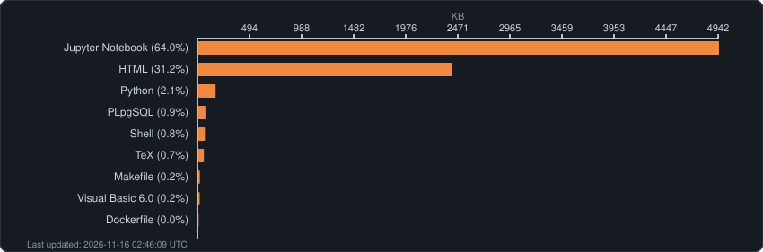
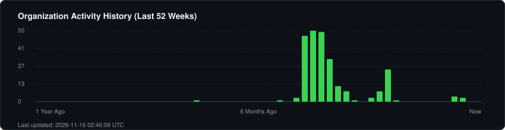

# Healthy Research Labs

  
  
  

**Healthy Research Labs (`@healthyinc-labs`)** operates as the dedicated scientific Research and Development (`R&D`), clinical validation, and exploratory Artificial Intelligence (`AI`) division of **[Healthy Inc. (`@healthyinc`)](https://github.com/healthyinc)**.

All federal grant initiatives — including United States National Science Foundation (`NSF`) and National Institutes of Health (`NIH`) Small Business Innovation Research (`SBIR`), Small Business Technology Transfer (`STTR`), and Translation to Practice (`TTP`) programs — alongside hospital reinforcement learning models, Intelligent Data Object (`IDO`) simulation harnesses, and credentialed clinical benchmarks hosted in this organization operate under Healthy Inc. stewardship.

---

## Ecosystem Architectural Division

To maintain strict regulatory boundaries, institutional data governance, and production security, the Healthy ecosystem enforces an architectural separation between commercial production systems and scientific research:

| Institutional Pillar | Organization | Core Scope & Responsibilities | Key Technologies |
| :--- | :--- | :--- | :--- |
| **Commercial Operations & Production Infrastructure** | **[Healthy Inc. (`@healthyinc`)](https://github.com/healthyinc)** | Commercial mobile application codebases, Habitcoin decentralized tokenomic protocol, Solana Virtual Machine (`SVM`) and Ethereum Virtual Machine (`EVM`) smart contract infrastructure, and enterprise clinical deployment pipelines. | React Native, Solana SVM, Rust, Eclipse SVM, Ethereum Sepolia, Amazon Web Services (`AWS`) Nitro Enclaves |
| **Scientific R&D & Federal Grants** | **Healthy Research Labs (`@healthyinc-labs`)** | Federal grant initiatives (`NSF` / `NIH`), hospital reinforcement learning simulations, multi-agent Care Traffic Control prototypes, physical AI biosensor fusion, and credentialed clinical data science benchmarks. | Python, PyTorch, DuckDB, Polars, Medical Information Mart for Intensive Care (`MIMIC`), PhysioNet Data Use Agreement (`DUA`), Gymnasium |

---

## 🏛️ Anonymized Scientific Research Capability Matrix (Execution Telemetry)

<!-- START_MATRIX -->
> Last updated: 2026-11-16 02:46 UTC · Active Scientific Research Capability Overview

| Scientific Research Domain | Tooling & Methodology Stack | Domain Scope & Research Deliverables | Lifetime Commits | 30-Day Velocity |
| :--- | :---: | :--- | :---: | :---: |
| **Clinical Data Science & Benchmarking** |        | Reproducible Cohort Isolation, Synthetic Health Datasets & Clinical Benchmarks under PhysioNet Data Use Agreements and HIPAA Standards | 📦 2,408 Commits | 🚀 7 Commits ⚪ Active Maintenance |
| **Federal Grants & Empirical Reproducibility** |     | NSF/NIH Empirical Validation Harnesses, Statistical Power Analysis & Formal Data Management and Sharing Plans (DMSP) | 📦 5 Commits | 🚀 0 Commits ⚪ Active Maintenance |
| **Hospital Reinforcement Learning & Simulation** |     | Multi-Agent Care Traffic Control Environments, Bed Allocation Optimization & Directed Acyclic Graph (DAG) Verification for Intelligent Data Objects (IDO) | 📦 0 Commits | 🚀 0 Commits ⚪ Active Maintenance |
| **Physical AI & Biosensor Edge Telemetry** |     | Low-Power Biosensor Fusion, Heart Rate Variability (HRV) & Photoplethysmography (PPG) Extraction, and Integrated Sensing and Communication (ISAC) | 📦 0 Commits | 🚀 0 Commits ⚪ Active Maintenance |

<!-- END_MATRIX -->

---

<!-- START_STATS -->
### 📈 Global Research Activity & Infrastructure
*   **Total Repositories:** 3 Repositories (2 Private, 1 Public)
*   **Organization Members:** 3 Active Members
*   **Total Lifetime Commits:** 2,413 Cumulative Commits
*   **Rolling 30-Day Velocity:** 7 Commits across active scientific research workstreams
*   **Active Researchers:** 3 Core Contributors
*   **Primary Languages:** Jupyter Notebook, HTML, Python, PLpgSQL, Shell, TeX, Makefile, Visual Basic 6.0

<!-- END_STATS -->

---

## 📊 Language Distribution by Code Volume (KB)

  

---

## 📈 Organization Activity History (Weekly Commits)

The multi-year activity chart below displays weekly commit volume across all scientific research workstreams:

  

---

## 🔒 Credentialed Clinical Data Governance & Zero-Leakage Architecture

All credentialed clinical evaluation pipelines, synthetic health dataset generators, and federal grant simulation harnesses are isolated behind zero-trust access controls in accordance with PhysioNet Data Use Agreements (`DUA`) and Health Insurance Portability and Accountability Act (`HIPAA`) Safe Harbor de-identification standards. Metrics displayed on this page represent anonymized, mathematical aggregates computed in-memory from finalized default-branch history.

---

## Frequent Contributors & Research Collaborators

<!-- START_COLLABORATORS -->

  
  
  

<!-- END_COLLABORATORS -->

---

## Navigation & Corporate Links

* **Corporate Parent Organization:** [Healthy Inc. (`@healthyinc`)](https://github.com/healthyinc)
* **Official Website:** [healthy.inc](https://healthy.inc)
* **General Research Inquiries:** [research@healthy.inc](mailto:research@healthy.inc)
